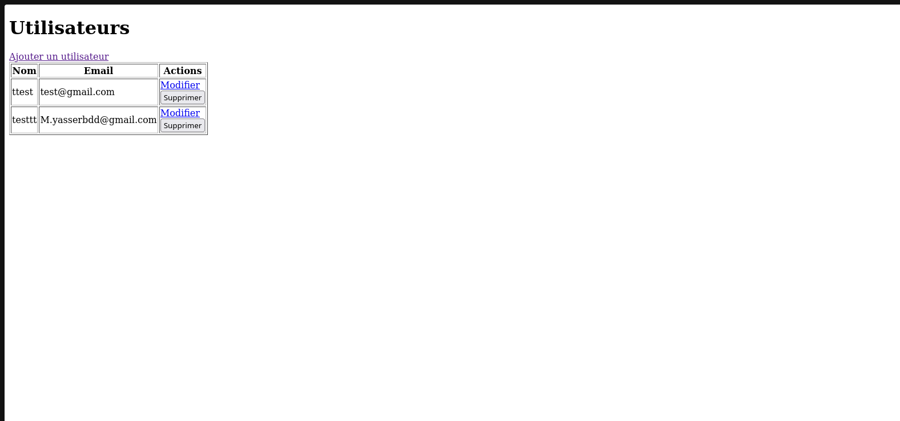
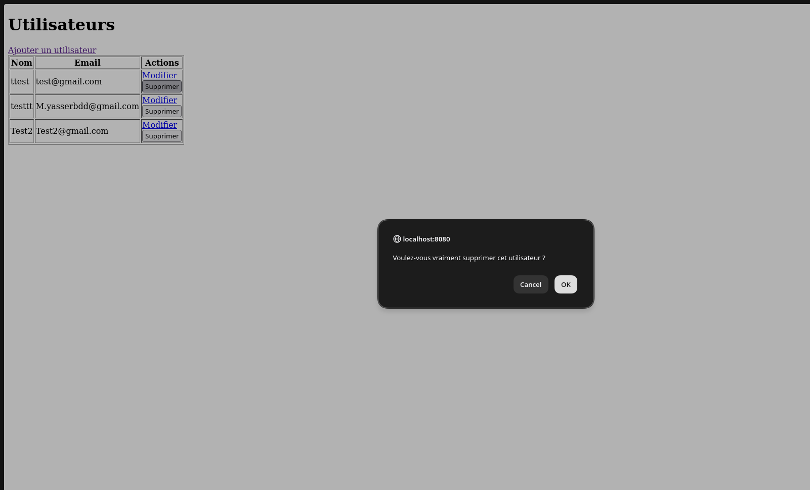
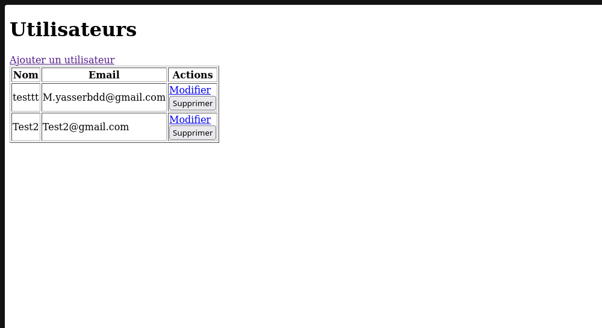
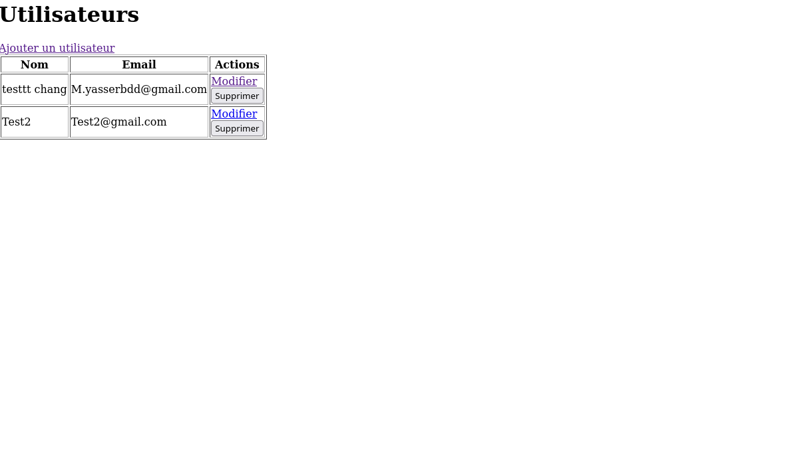

# TP6 — Spring Boot et Thymeleaf

Dans ce TP, nous avons développé une application de gestion d’utilisateurs avec Spring Boot, Spring Data JPA et Thymeleaf. Les données sont enregistrées dans MariaDB, utilisée sur mon PC à la place de MySQL.

La page affiche les noms et les emails des deux utilisateurs déjà enregistrés. Chaque ligne propose les actions Modifier et Supprimer. Le lien Ajouter un utilisateur ouvre le formulaire d’ajout.

Nous avons renseigné le nom Test2 et l’email Test2@gmail.com. Le bouton Enregistrer permet d’ajouter cet utilisateur et de revenir à la liste.

La liste contient maintenant trois utilisateurs, dont Test2. En cliquant sur Supprimer, le navigateur demande une confirmation. Cancel annule l’action et OK confirme la suppression.

Après confirmation, le premier utilisateur a été supprimé. La liste contient les deux utilisateurs restants, dont Test2.

Nous avons ensuite modifié le nom d’un utilisateur avec l’action Modifier. La liste affiche le nouveau nom, tandis que son adresse email est conservée.
